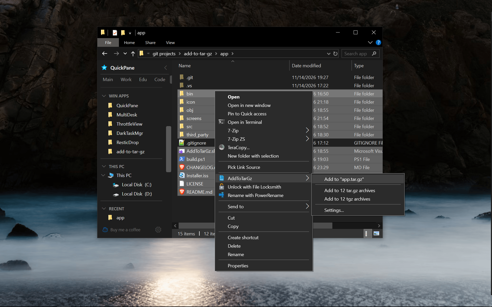
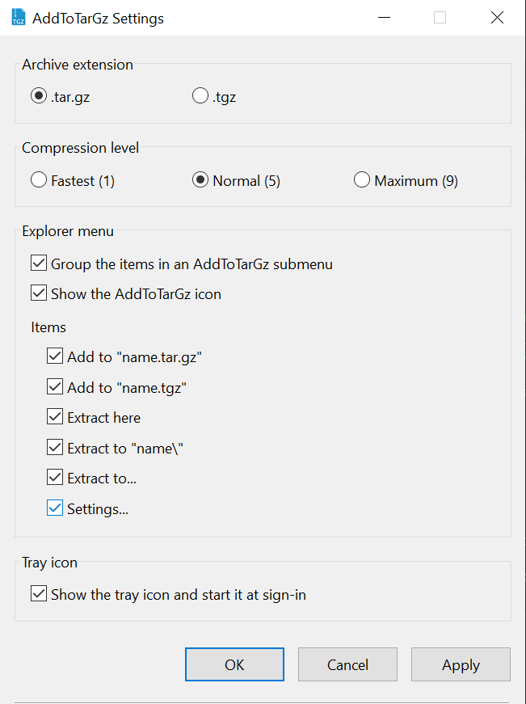
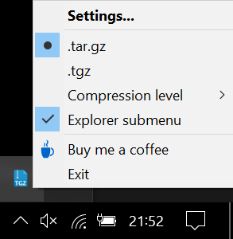

# AddToTarGz


One-click tar.gz for Windows File Explorer. Right-clicking any file or folder opens an **AddToTarGz** submenu with **Add to "name.tar.gz"**, and right-clicking any `.tar.gz` or `.tgz` opens it with **Extract here**, **Extract to "name\\"** and **Extract to...**. Every job is run by the bundled 7-Zip in the background with no console window, an existing file or folder is never overwritten, and 7-Zip's own messages appear when a job does not finish. The extension (`.tar.gz` or `.tgz`), the compression level and the menu entries are set in a settings window and from a tray icon. The install is per user, with no administrator rights and nothing else to install.



## Summary

AddToTarGz turns tar.gz work into a single click in Explorer, with:

- **One-click add**: any file or folder becomes `name.tar.gz` beside it
- **One-click extract**: into a folder named after the archive, straight into the current folder, or into a folder picked in a dialog
- **One submenu**: every entry is in one AddToTarGz cascading submenu, the same kind of submenu 7-Zip adds to Explorer, or in the main menu with one setting
- **Exact names in the menu**: each entry shows the name of the archive or folder that clicking it creates
- **Tray icon and settings window**: `.tar.gz` or `.tgz`, compression level, menu entries, and the tray icon itself
- **Update check**: the settings window shows whether GitHub has a newer release, with a Download button for it
- **No overwrites**: new output is named `name (2)`, `name (3)` and onward whenever the plain name is taken
- **One folder level**: `site.tar.gz` holding `site/` is extracted into a single `site\` folder
- **No temporary files**: the 7-Zip stages are joined by pipes, and no intermediate `.tar` is written to disk
- **Truthful reports**: a job that does not finish shows 7-Zip's exit codes and messages, and its output has a `.partial` suffix
- **Safe extraction**: links pointing outside the folder are refused, and entries Windows cannot store are renamed
- **Any file name**: Unicode, `!`, `%`, `&`, `( )`, a leading `-` or `@`, and paths past 260 characters
- **7-Zip included**: the official 7-Zip 26.06 console program is part of the installer
- **Per-user install**: no administrator rights, nothing in System32, one uninstall entry
- **Command line**: `AddToTarGz.exe --add` and `--extract` for scripts, with exit codes

## Features

### The AddToTarGz submenu

Right-clicking shows one **AddToTarGz** entry with the tgz icon, and its submenu has the entries for the selection.

| Selection | Entries |
|---|---|
| One file or folder that is not an archive | `Add to "name.tar.gz"` (and `Add to "name.tgz"` when switched on), `Settings...` |
| Several items, not all archives | `Add to "folder.tar.gz"`, a divider, `Add to 3 tar.gz archives` (and `Add to 3 tgz archives` when switched on), `Settings...` |
| Only `.tar.gz` and `.tgz` files | `Extract here`, `Extract to "name\"`, `Extract to...`, `Settings...` |
| A drive root | no entries |

- Each entry can be switched off in the settings window, and the submenu can be replaced by entries in the main menu. The one-archive entry for several items has no switch
- Several selected items show counts: `Add to 3 tar.gz archives`, `Extract to 3 folders`

### Add to tar.gz

`Add to "name.tar.gz"` shows the exact name of the new archive.

- A folder has its full name in the archive name: `example.com` becomes `example.com.tar.gz`
- The archive of a file is named without the file's last extension: `backup.sql` becomes `backup.tar.gz`
- The archive's root entry is the item's own name, the layout Linux `tar` archives use
- Several selected items go into one archive with `Add to "folder.tar.gz"`, named after their folder, with each item as a root entry. `Add to 3 tar.gz archives` gives one archive per item
- Compression is gzip level 1, 5 or 9, set in the settings window or the tray menu (5 by default)
- A progress window with a Cancel button appears for jobs longer than half a second

### Extract

- **Extract to "name\\"** creates a new folder named after the archive, beside it
- **Extract here** places the archive's entries straight into the archive's folder. An entry whose name is taken is named `name (2)`, `readme (2).txt` and onward
- **Extract to...** opens a folder dialog, then creates the new folder inside the picked folder. Closing the dialog extracts nothing
- An archive whose only root folder has the archive's own name is extracted one level deep: the contents of `site/` inside `site.tar.gz` are placed in `site\`
- An archive with any other layout has that same layout inside the new folder
- Names Windows cannot store, such as `aux.txt` or `a:b.txt`, are written as `_aux.txt` and `a_b.txt`

### Settings window

The settings window is opened from `Settings...` in the AddToTarGz submenu, by left-clicking the tray icon, and from **AddToTarGz Settings** in the Start menu.



- **Archive extension**: `.tar.gz` or `.tgz` for `Add to "name.<ext>"`
- **Compression level**: Fastest (1), Normal (5) or Maximum (9)
- **Explorer menu**: the AddToTarGz submenu on or off, the tgz icon on or off, and one switch per entry
- **Tray icon**: the tray icon, and its start at sign-in
- Clicking OK or Apply saves the values, and the Explorer menu is built with them from the next right-click on
- The footer shows the version and the update status: **Up to date**, or **Version X is available** with a **Download X** button. Below them are GitHub's mark with a **GitHub** link to the repository, and a **Buy me a coffee** button

### Tray icon

The tray icon is started at sign-in. Left-clicking it opens the settings window, and right-clicking it opens its menu:

- **Settings...**
- **.tar.gz** and **.tgz**
- **Compression level** with Fastest (1), Normal (5) and Maximum (9)
- **Explorer submenu** on or off
- **Buy me a coffee**, the PlexPixel donate page
- **Exit**, until the next sign-in



Turning the tray icon off in the settings window removes it and its start at sign-in. The settings window can then be opened from the Explorer menu and the Start menu.

### Unique names and partial output

Every job's output is written under a name nobody else holds, then renamed to the final name.

- New output is named `name (2)`, `name (3)` and onward whenever the plain name is taken, for archives and for folders
- Work in progress has a `.partial` suffix: `site.tar.gz.partial` while compressing, `site.partial` while extracting
- The `.partial` output of a failed or canceled job is left in place, and the report shows its path
- A leftover `.partial` name counts as taken

### Reports

A job that finishes cleanly shows nothing. The new archive or folder appears beside the original.

- 7-Zip warnings, such as a file another program had locked, appear in a dialog after the archive is finished
- A job that fails shows each 7-Zip stage's exit code and message, word for word

## Requirements

- **Windows 10 or Windows 11**, 64-bit (developed and tested on Windows 10 IoT Enterprise LTSC 21H2)
- No separate 7-Zip install: the installer has 7-Zip's `7za.exe` 26.06
- To build from source: **Visual Studio 2026** (v145 toolset) with the Desktop development with C++ workload
- To build the installer: **[Inno Setup](https://jrsoftware.org/isinfo.php) 7**, tested with 7.0.1-beta

## Installation

### Option A: Run a release build

1. Download the latest `AddToTarGzSetup-<version>.exe` from the Releases page (or build it yourself below)
2. Run the installer. The install is per user with no administrator rights
3. The tray icon is started at the end. The last page has a check box for opening the settings window
4. Right-click any file, folder, or archive in Explorer

### Option B: Build from source

```bash
git clone https://github.com/lso2/add-to-tar-gz.git
```

**Build the binaries**

1. Run `powershell -ExecutionPolicy Bypass -File build.ps1`, or open `AddToTarGz.slnx` in Visual Studio and build **Release | x64**
2. `AddToTarGz.exe`, `AddToTarGzTray.exe`, `targz_context.dll` and a copy of `7za.exe` are written to `bin\x64\Release`

**Build the installer**

1. Build the binaries first. The source paths in the `[Files]` section of `Installer.iss` are in `bin\x64\Release`
2. Open `Installer.iss` in Inno Setup and press **Compile**
3. The single-file `AddToTarGzSetup-<version>.exe` is written to the `Output` folder

> The installer's version number is read from the built `AddToTarGz.exe`. The exe's version number is set in `src\shared\version.h`.

### Upgrading from 1.x

Version 1.x was installed for all users: a DLL in System32, verbs under `HKEY_CLASSES_ROOT`, and scripts in `%ProgramData%\AddToTarGz`. The per-user 2.x installer has no rights to those entries.

1. Right-click `%ProgramData%\AddToTarGz\uninstall.bat` and choose **Run as administrator**
2. Run the 2.x installer

## Usage

### Adding

- Right-click a file or folder, open **AddToTarGz**, and choose `Add to "name.tar.gz"`
- Select several items first: `Add to "folder.tar.gz"` puts all of them into one archive named after their folder, and `Add to N tar.gz archives` makes one archive per item
- Clicking **Cancel** in the progress window stops the job and leaves `name.tar.gz.partial`

### Extracting

- Right-click a `.tar.gz` or `.tgz`, open **AddToTarGz**, and choose `Extract here`, `Extract to "name\"` or `Extract to...`
- Select several archives first for one result per archive. With `Extract to...` one folder is picked for all of them

### Command line

```
AddToTarGz.exe --add [--one] [--ext tar.gz|tgz] [--level 1-9] [--silent] [--] <file or folder>...
AddToTarGz.exe --extract [--here | --dest <folder> | --pick-dest] [--silent] [--] <archive.tar.gz or archive.tgz>...
```

- `--ext` is the extension for `--add`, `tar.gz` by default, and `--level` is the gzip level, 5 by default
- With `--one`, every item goes into one archive named after the folder of the first item, in that folder
- With `--here`, the entries are extracted straight into the archive's folder
- With `--dest`, the new folders are created in another folder
- With `--pick-dest`, that folder is picked in a dialog
- With `--silent`, no window or dialog appears, and `--pick-dest` with `--silent` is refused
- Standard output has one line per job: `DONE`, `WARNINGS`, `FAILED`, `CANCELLED` or `NOT STARTED`, a tab, the input path, a tab, and the output path, with any 7-Zip messages indented below
- Exit codes: `0` every job finished cleanly, `1` a job ended with warnings, failed or was canceled, `2` the command line was not valid
- No settings are read on the command line, and the Explorer menu passes `--ext` and `--level` from the settings

## Settings and data

Every installed file and registry entry is per user:

```
%LOCALAPPDATA%\AddToTarGz\
├── build-<yymmddhhnnss>\     # The installed build, one folder per setup
│   ├── AddToTarGz.exe       # Worker: 7-Zip for each add and extract job
│   ├── AddToTarGzTray.exe   # Tray icon and settings window
│   ├── targz_context.dll    # Explorer menu handler
│   ├── 7za.exe              # 7-Zip 26.06 console program
│   └── 7-Zip License.txt    # 7-Zip's license
├── LICENSE.txt              # GNU GPLv3
└── unins000.exe / .dat      # Inno Setup uninstaller

Start menu\Programs\AddToTarGz Settings   # Shortcut to the settings window

HKCU\Software\AddToTarGz
├── Extension            # "tar.gz" or "tgz"
├── CompressionLevel     # 1, 5 or 9
├── Submenu              # 1: entries in the AddToTarGz submenu, 0: in the main menu
├── MenuIcons            # 1: tgz icon in the menu
├── ItemAdd              # 1: Add to "name.<ext>"
├── ItemAddOther         # 1: Add to "name.<other ext>" (0 by default)
├── ItemExtractHere      # 1: Extract here
├── ItemExtractFolder    # 1: Extract to "name\"
├── ItemExtractTo        # 1: Extract to...
├── ItemSettings         # 1: Settings... in the Explorer menu
└── TrayIcon             # 1: tray icon, started at sign-in

HKCU\Software\Microsoft\Windows\CurrentVersion\Run
└── AddToTarGz           # "...\AddToTarGzTray.exe" --tray, while the tray icon is on

HKCU\Software\Classes
├── CLSID\{BF8A488E-EBA4-4D70-8486-<yymmddhhnnss>}               # Menu handler class of the installed build
└── AllFilesystemObjects\shellex\ContextMenuHandlers\AddToTarGz  # Menu handler on files and folders
```

A missing value under `HKCU\Software\AddToTarGz` means its default. Uninstalling deletes every entry above.

### Privacy

- **One network request**: opening the settings window asks `api.github.com` for the latest release. The request has the app name and version in its User-Agent and no other data
- **No telemetry**: no usage data is collected or sent
- **Local jobs**: 7-Zip reads and writes local files only
- **No accounts**: no login or registration
- **One background process**: `AddToTarGzTray.exe` for the tray icon, waiting for a click. With the tray icon off, nothing runs between jobs

## Compatibility

| OS | Supported | Notes |
|----|-----------|-------|
| Windows 10 (incl. LTSC) | ✅ | Developed and tested on Windows 10 IoT Enterprise LTSC 21H2 |
| Windows 11 | ⚠️ | Untested. App commands at the top level of the Windows 11 menu are limited to apps with a package identity, and AddToTarGz has none. Clicking **Show more options** opens the Windows 10 menu with the AddToTarGz submenu |
| Windows 8.1 and older | ⚠️ | Untested |
| macOS / Linux | ❌ | Windows only (Explorer shell extension) |

## Troubleshooting

### The AddToTarGz submenu or an entry is missing

The Add entries are shown for any selection holding at least one file or folder that is not an archive, and the Extract entries when every selected item is a `.tar.gz` or `.tgz`. Drive roots get no entries. Each entry has a switch in the settings window, except the one-archive entry for several items, and an entry switched off is not shown. With every entry for a selection switched off, the AddToTarGz submenu is not shown either.

### The tray icon is not next to the clock

Windows can place a new notification icon in the hidden icons area, the **^** arrow next to the clock. Dragging the AddToTarGz icon from there onto the taskbar places it next to the clock. With **Show the tray icon and start it at sign-in** off in the settings window, there is no icon.

### The settings window shows "Update check failed"

Hovering over **Update check failed** shows the reason: the WinHTTP error, such as a timeout, or the HTTP status from `api.github.com` with GitHub's message. GitHub allows 60 anonymous API requests an hour per IP address. The check is run again the next time the settings window opens.

### 7za.exe was not found

`7za.exe` is installed beside `AddToTarGz.exe` in the build folder inside `%LOCALAPPDATA%\AddToTarGz`. Running the installer again puts it back, and the error dialog shows the full path that was checked.

### A file or folder ending in .partial appeared

That job did not finish, and its report dialog showed the reason. The `.partial` output is incomplete and can be removed once the reason is clear.

### "Dangerous link path was ignored" during extraction

The archive has a symbolic link pointing outside the extraction folder. The link was refused, and the remaining entries were extracted into `name.partial`.

### "There are some data after the end of the payload data" during extraction

Archives made by Windows `tar.exe` have zero padding after the gzip data. Every entry is extracted, the 7-Zip exit code is still 2, and the files are left in `name.partial`.

### Two Add or two Extract entries appear

Version 1.x is still installed. It is uninstalled with the steps under [Upgrading from 1.x](#upgrading-from-1x).

### An older build folder is still in %LOCALAPPDATA%\AddToTarGz

`targz_context.dll` is loaded in Explorer after a right-click, and Windows does not allow a loaded DLL to be replaced or deleted. Setup never closes Explorer and never asks for a restart: each setup installs into a new build folder and registers a new menu class, and Explorer's next right-click loads the new build's menu. A file of an earlier build that a program still holds stays until it is released, and the tray app deletes it at its next start, at the latest after the next sign-in.

## Architecture

AddToTarGz is three binaries built on documented Win32 and COM interfaces.

- **targz_context.dll** is an `IContextMenu` handler registered under `AllFilesystemObjects`, with a new class identifier for each installed build. The selection is read from `CF_HDROP`, the settings are read on every right-click, and the entries are inserted as one cascading submenu or as main menu entries at the position Explorer passes
- **Clicking an entry** starts `AddToTarGz.exe` from the DLL's own folder with the selected paths and the options for that entry, or `AddToTarGzTray.exe --settings` for `Settings...`. The one-archive entry hands every path over in shared memory, with no command line limit on the selection
- **AddToTarGz.exe** is a GUI-subsystem program with no console window. Each job is two `7za.exe` processes joined by anonymous pipes: tar then gzip for add, gunzip then untar for extract. Only the `7za.exe` beside the exe is run
- **Each 7-Zip process has only its own pipe ends**, set through `PROC_THREAD_ATTRIBUTE_HANDLE_LIST`. A pipe is closed when its writing process exits
- **Names are reserved atomically**: `CreateFileW` with `CREATE_NEW` for `name.tar.gz.partial`, `CreateDirectoryW` for `name.partial`, then `MoveFileExW` without replace for the finished name
- **AddToTarGzTray.exe** is one instance per user session. It has a hidden top-level window for the notification icon, the tray menu and the modeless settings window, and it writes `HKCU\Software\AddToTarGz` and the Run value
- **The update check** is one WinHTTP request to the GitHub releases API on a background thread, started when the settings window opens. The release tag is compared with `src\shared\version.h`, and the result is posted to the tray window
- **The naming rules are one source file** (`src\shared\names.cpp`) compiled into all three binaries, and the menu label always matches the output name
- **COM lifetime is counted**: the `DllCanUnloadNow` result is based on the number of live objects and server locks
- **7-Zip's messages are captured as UTF-8** (`-sccUTF-8`) and shown verbatim

## Project structure

```
add-to-tar-gz/
├── AddToTarGz.slnx              # Visual Studio solution with the 3 projects
├── build.ps1                    # Build script (newest Visual Studio)
├── Installer.iss                # Inno Setup per-user installer
├── CHANGELOG.md                 # Version history
├── LICENSE                      # GNU GPLv3
├── icon/
│   ├── tgz.ico                  # Icon for the menu, the tray, the exes and the uninstall entry
│   └── github-mark.png          # GitHub's mark for the settings footer
├── third_party/
│   └── 7-Zip/                   # 7za.exe 26.06 and its License.txt, from the official 7-Zip Extra package
└── src/
    ├── shared/                  # Compiled into more than one binary
    │   ├── settings.cpp/.h      # HKCU\Software\AddToTarGz
    │   ├── names.cpp/.h         # Archive and folder naming rules
    │   ├── paths.cpp/.h         # Long paths, roots, module path
    │   ├── cmdline.cpp/.h       # Command line quoting
    │   ├── errors.cpp/.h        # Windows error text
    │   ├── version.h            # Version numbers
    │   └── resource_ids.h       # Resource identifiers
    ├── worker/                  # AddToTarGz.exe
    │   ├── AddToTarGz.vcxproj
    │   ├── main.cpp             # Entry point and job loop
    │   ├── args.cpp/.h          # Command line options
    │   ├── sevenzip.cpp/.h      # 7za.exe path and each stage's switches
    │   ├── child.cpp/.h         # One hidden 7-Zip process
    │   ├── pipes.cpp/.h         # Pipes and the counting relay
    │   ├── stages.cpp/.h        # Two 7-Zip processes joined by pipes
    │   ├── add_job.cpp/.h       # Add jobs: one archive per item, or one for all items
    │   ├── extract_job.cpp/.h   # One extract job
    │   ├── folder_picker.cpp/.h # The Extract to folder dialog
    │   ├── fs_ops.cpp/.h        # Sizes, listing, 7-Zip list file, final rename
    │   ├── job_result.h         # Outcome of one job
    │   ├── progress.cpp/.h      # State shared with the window
    │   ├── progress_window.cpp/.h # Progress window
    │   ├── report.cpp/.h        # Standard output lines and the report dialog
    │   ├── worker.rc            # Icon and version information
    │   └── worker.manifest      # Themed controls, DPI awareness, long paths
    ├── menu/                    # targz_context.dll
    │   ├── targz_context.vcxproj
    │   ├── targz_context.def    # COM exports
    │   ├── dllmain.cpp          # DLL and COM entry points
    │   ├── module.cpp/.h        # Module handle and live-object count
    │   ├── class_factory.cpp/.h # COM class factory
    │   ├── context_menu.cpp/.h  # IShellExtInit and IContextMenu, the submenu
    │   ├── menu_entries.cpp/.h  # Entries, verbs and labels for a selection
    │   ├── selection.cpp/.h     # Selection reading and menu labels
    │   ├── menu_bitmap.cpp/.h   # Icon as a transparent menu bitmap
    │   ├── launch.cpp/.h        # Start of AddToTarGz.exe or the settings window
    │   ├── clsid.h              # Class identifier of the menu handler
    │   └── menu.rc              # Icon and version information
    └── tray/                    # AddToTarGzTray.exe
        ├── AddToTarGzTray.vcxproj
        ├── main.cpp             # Entry point, one instance, message loop
        ├── tray_window.cpp/.h   # Hidden window for icon events and closing
        ├── tray_icon.cpp/.h     # The notification icon
        ├── tray_menu.cpp/.h     # The tray icon's right-click menu
        ├── settings_dialog.cpp/.h # The settings window
        ├── settings_footer.cpp/.h # Version, update status, GitHub link, Buy me a coffee
        ├── update_check.cpp/.h  # GitHub latest-release request on a thread
        ├── update_result.h      # Outcome of one update check
        ├── github_release.cpp/.h # Version and download address of a release
        ├── release_version.cpp/.h # Release tags as version numbers
        ├── json_reader.cpp/.h   # JSON parser for the GitHub answers
        ├── coffee_icon.cpp/.h   # The coffee cup image
        ├── github_mark.cpp/.h   # GitHub's mark from icon\github-mark.png
        ├── web_link.cpp/.h      # Opens a web address in the browser
        ├── links.h              # GitHub and donate addresses
        ├── autostart.cpp/.h     # The Run value for the start at sign-in
        ├── old_builds.cpp/.h    # Removes earlier build folders at the tray app's start
        ├── tray_ids.h           # Dialog, control and menu identifiers
        ├── tray.rc              # Icon, settings dialog and version information
        └── tray.manifest        # Themed controls, per-monitor DPI awareness
```

## Contributing

1. Fork the repository
2. Create a feature branch (`git checkout -b feature/amazing-feature`)
3. Make your changes (keep to documented Win32 and COM, C++17, and the v145 toolset)
4. Build with `build.ps1` and test on Windows 10 or 11
5. Commit your changes (`git commit -m 'Add amazing feature'`)
6. Push to the branch (`git push origin feature/amazing-feature`)
7. Open a Pull Request

## Author

PlexPixel ([plexpixel.com](https://plexpixel.com))

## License

GPLv3, see the [LICENSE](LICENSE) file for details.

The bundled `7za.exe` is 7-Zip by Igor Pavlov, under the GNU LGPL with parts under the BSD 3-clause and 2-clause licenses. Its license text is installed as `7-Zip License.txt`, and the source code is at [7-zip.org](https://www.7-zip.org/).

---

**⭐ If AddToTarGz made tar.gz a one-click job, please star the repository!**

## ☕ Buy me a coffee

If AddToTarGz saves you time every day, consider supporting its development.

[](https://plexpixel.com/donate)

**Supported work:**

- ☕ Continued development
- 🚀 New features
- 🐛 Faster fixes and updates
- 📚 Better documentation

---

*Made with ❤️ for people who ship tar.gz files from Windows.*
